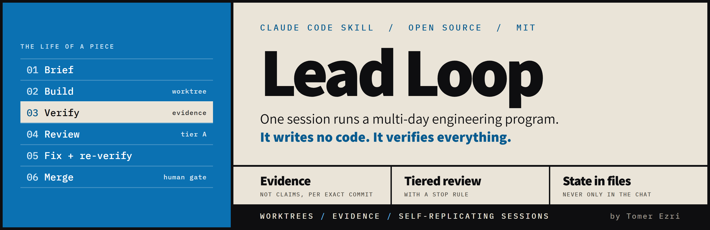
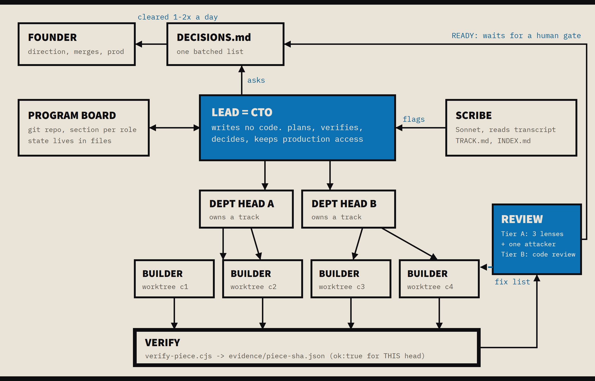
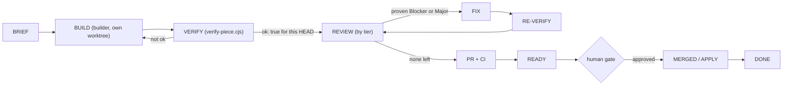
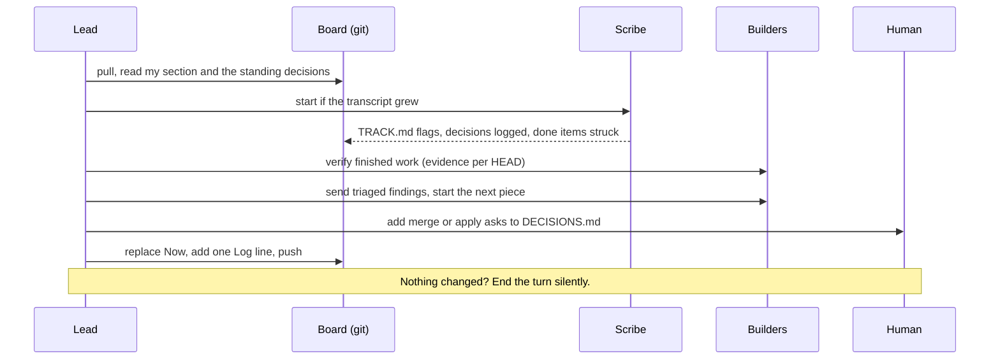

<p align="center">
  
</p>

> **A Claude Code skill that turns one session into the CTO of a multi-day, many-PR engineering program. It writes no code. It hands pieces to builders, checks every result with a machine, and only bothers you with a short list.**

*Social preview line: One Claude Code session runs your whole program: builders in worktrees, evidence files instead of "tests pass", tiered review, one batched decisions list for you.*

---

## The problem

You start a big piece of work with Claude Code: a platform migration, a refactor series, an audit-and-fix batch. Thirty PRs, two weeks. By day three this is what happens:

- A builder says "all tests pass" and you merge. CI is red an hour later.
- Review never ends. Every fresh reviewer is asked to find problems, so every fresh reviewer finds some.
- The conversation grows, gets compacted, and a decision you made on day 2 is gone. The next session tells you something that contradicts it.
- You become a step in the loop. Every message is "can I merge?", "can I apply this?", "what now?".
- The session dies, and so does everything that only lived in it.

Lead Loop is the set of rules, templates and two small scripts that fix those five things. It was written down while running a multi-week software program with one lead session and a team of builder agents. [Field notes](skill/references/FIELD-NOTES.md) lists the failure classes and what each one changed.

## The concept

Five ideas. Everything else in the skill is detail.

1. **The session IS the loop.** The lead does not wait for you between steps. It briefs a builder, verifies the result, has it reviewed, sends it back, verifies again, and moves to the next piece. You are not a step. You set direction and clear a list.
2. **Evidence, not claims.** "Tests pass" is a claim. A piece is verified only when `verify-piece.cjs` has written `ok: true` into an evidence JSON for the exact commit. Agents declare victory early; a file bound to a commit hash cannot.
3. **Review by risk, with a stop rule.** Money, migrations and anything irreversible (Tier A) get one blind panel of three narrow lenses, a devil's advocate, and a cap of two panels. Tests, tooling and docs (Tier B) get a light review. A finding counts only if it comes with a failing test or a confirmed file and line.
4. **State lives in files, never in the chat.** One shared board in a git repo, one section per role. A scribe agent reads the lead's transcript and keeps the record, so a decision does not depend on the lead remembering to write it down.
5. **The human gets a short batched list.** Merges and production changes wait on you; nothing else does. The lead keeps working on everything that does not need you.

## Architecture

<p align="center">
  
</p>

The life of one piece:



One tick of the loop (every time the lead gets control):



## What it looks like

Everything here is synthetic. The evidence files are the real output of [`examples/demo/run-demo.cjs`](examples/demo/run-demo.cjs), which you can run in a second (SHAs replaced).

### An evidence file (green)

A tiny module, one test. The verifier runs the manifest, then writes this for the exact commit:

```json
{
  "piece": "green-piece",
  "head": "1a2b3c4d5e6f7a8b9c0d1e2f3a4b5c6d7e8f9a0b",
  "ok": true,
  "at": "2026-01-05T10:00:00.000Z",
  "results": [
    {
      "name": "price",
      "cmd": ["node", "test-price.cjs"],
      "exit": 0,
      "lastLine": "PASS price: 1/1 checks",
      "expect": "PASS price: 1/1",
      "pass": true,
      "ms": 108
    }
  ]
}
```

### An evidence file (red)

Same repo, but a builder "fixed" a test instead of the code. The piece is NOT verified and the failing tail is kept:

```text
PASS price: exit 0, last line: PASS price: 1/1 checks
FAIL rounding: exit 1, last line: FAIL rounding: got 30, want 31
NOT VERIFIED red-piece at 1a2b3c4d5e6f
```

See [`examples/evidence/`](examples/evidence/) for both files in full.

### The board

A board is one markdown file with a section per role. The top block is the standing founder decisions, quoted with their date ([full excerpt](examples/board-excerpt.md)):

```markdown
## 0. Standing founder decisions
- Day 3 | "Ship the sync engine first. Tags, sharing and the admin
  screens are after launch." | Launch cut = 9 pieces (file: cut-v2.md).
- Day 5 | "Never turn the new sync on for everyone without me." | Founder-only production change.
- Current launch cut: cut-v2.md. Pieces left: 4 of 9. Pace: 1.5/day. Implied finish: day 12.
```

### A scribe TRACK flag

The scribe reads the transcript, the board and git, and tells the lead what drifted ([full sample](examples/track-sample.md)):

```markdown
## Run Day 7 13:00
- FLAG: work on a deferred piece. Builder b-r1 committed sharing-ui work at 11:20.
  The launch cut (cut-v2.md, line 14) defers it. Founder decision, Day 6 21:02:
  "Let's drop sharing from the first release."
- FLAG: date drift. 4 pieces left at 1.5/day implies Day 10. Last date given
  to the founder: Day 8.
```

### The decisions list

Everything that needs you, in one table, each with the lead's call and the evidence ([sample](examples/decisions-sample.md)):

```markdown
| # | Opened      | Decision                                   | Tier | Lead's call and evidence                         | Status |
| 3 | Day 7 12:45 | Apply migration 0007 to production         | A    | Would apply: yes. Dry run clean; post-checks     | open   |
|   |             |                                            |      | written first. evidence/n3-9f8e7d6c5b4a.json     |        |
| 2 | Day 7 12:40 | Merge PR #14 (conflict resolution)           | A    | Would merge: yes. Evidence ok, CI green, panel   | open   |
|   |             |                                            |      | found no proven Blocker or Major                 |        |
```

## Install

Needs Claude Code and Node 18 or newer (for the two scripts). Copy the `skill` folder into your skills directory under the name `lead-loop`:

```bash
git clone https://github.com/FuzulsFriend/claude-lead-loop
mkdir -p ~/.claude/skills
cp -r claude-lead-loop/skill ~/.claude/skills/lead-loop
```

On Windows (PowerShell):

```powershell
git clone https://github.com/FuzulsFriend/claude-lead-loop
Copy-Item -Recurse claude-lead-loop\skill $HOME\.claude\skills\lead-loop
```

Check the scripts:

```bash
node ~/.claude/skills/lead-loop/scripts/verify-piece.cjs --self-test
node ~/.claude/skills/lead-loop/scripts/scribe-digest.cjs --self-test
node claude-lead-loop/examples/demo/run-demo.cjs      # green and red evidence, end to end
```

Pairs well with [claude-usage-limits](https://github.com/FuzulsFriend/claude-usage-limits) (the loop reads it on every tick) and [adversarial-review](https://github.com/FuzulsFriend/adversarial-review) (the review format for the panels). Both are optional.

## Use it

Start a program the way you would brief a CTO:

> Run this as a lead loop: ship the sync engine described in `specs/sync.md`. Builders in worktrees, you verify. I merge and I approve anything that touches production.

The skill triggers on phrases like "loop", "keep going", "finish this", "run it autonomously", "lead session", "builders", "pipeline", or when a session picks up a handoff or ledger for multi-PR work. On day one the lead creates the program folder from [`skill/assets/`](skill/assets/): board (or ledger), decisions list, builder rules, evidence folder.

For a single small change, do not use it. The overhead is not worth it.

## What is in the box

| Path | What it is |
|---|---|
| [`skill/SKILL.md`](skill/SKILL.md) | The skill. Frontmatter (`name`, `description`) plus the full rules. |
| [`skill/scripts/verify-piece.cjs`](skill/scripts/verify-piece.cjs) | Runs a manifest in a worktree, writes `evidence/<piece>-<sha12>.json`. Has `--self-test`. |
| [`skill/scripts/scribe-digest.cjs`](skill/scripts/scribe-digest.cjs) | Turns a session transcript into a masked digest the scribe reads. Cursor-based. Has `--self-test`. |
| [`skill/scripts/gated.cjs`](skill/scripts/gated.cjs) | RAM gate: waits for free memory, then runs a command in the foreground. |
| [`skill/assets/`](skill/assets/) | Templates: board, ledger, decisions, builder rules, brief, handoff, merge queue, scribe brief, tick prompt. |
| [`skill/references/research.md`](skill/references/research.md) | How Anthropic, Karpathy, Carlini, Willison, Cursor and others run long agent work, with what each source did and did not verify. |
| [`skill/references/FIELD-NOTES.md`](skill/references/FIELD-NOTES.md) | What went wrong in real use, and the rule each failure produced. |
| [`skill/references/successor-handover.md`](skill/references/successor-handover.md) | How a session starts its own successor through a one-time scheduled task. |
| [`examples/`](examples/) | A runnable demo, evidence files, a board excerpt, a TRACK sample, a decisions list, a scribe digest. |
| [`assets/`](assets/) | The banner and architecture diagram. |

## The scribe

A lead under load forgets to log. So a separate, cheap agent keeps the record, and it reads the lead's transcript itself instead of waiting to be told.

- `scribe-digest.cjs` reduces the transcript since the last cursor to a short digest: the human's typed messages verbatim, timed prompts and agent messages labelled apart, the lead's replies. Tool output is dropped and secrets are masked.
- The scribe writes only files it owns: the standing-decisions block, append-only decision lines, struck-off done items (only with evidence, such as a merged PR sha), an `INDEX.md`, and `TRACK.md`.
- The lead reads `TRACK.md` on every tick and acts on each flag, or answers it with a reason.

## Self-replicating handover

When a session needs a successor, it starts the successor itself, through a one-time scheduled task of your operating system. It never starts it as a child process (a session launched from inside another saves no transcript and cannot be resumed). Then it reports **SAFE TO CLOSE** with a checklist, and only the close of the old window waits for you. [Details and Windows, macOS and Linux sketches](skill/references/successor-handover.md). The sketches are not tested scripts; the rest of the repo is.

## Field notes

Five of the failure classes this skill is built from (general lessons, in [FIELD-NOTES.md](skill/references/FIELD-NOTES.md)):

- **A decision that never reached the next session.** A scope decision lived only in one conversation, so a later answer contradicted it. Now: a standing-decisions block opens the board, every handoff copies it, and a scribe keeps it current.
- **A state file that was out of date.** A session called a moment safe to compact while its own state file was stale. Now: rewrite the Now block with the clock time first, then say it.
- **Green locally, red in CI.** Manifests had been built from the briefs. Now: build them from the CI steps the changed paths trigger.
- **A test that proved nothing.** A test was green before and after the change. Now: every change ships a check that fails when the change is undone, with the red line recorded.
- **Review without end.** Repeated full panels kept finding something. Now: tiers, proven findings only, a hard cap on panels.

## FAQ

**Does the lead really never wait for me?**
It never waits inside the loop. Merges and production changes still need your go; those go on a list and the lead moves to other pieces. You can delegate merges explicitly, and the skill treats that as a standing go only for fully gated packages.

**Why a Sonnet scribe and not the lead?**
The lead is the scarcest context in the program, and every lead tool call re-reads all of it. A cheap agent with a small context does the record for a fraction of the cost, and it does not forget, because it reads the transcript.

**How many agents does this run?**
At most about three heavy ones at once. Multi-agent work costs several times the tokens of a chat; the skill says to announce a workflow's size as "N agents plus 2 per serious finding" so the bill is no surprise.

**Does it work without a second PC, departments or Remote Control?**
Yes. Departments and a second machine are for big programs. A single-session program uses a `LEDGER.md` instead of the shared board.

**Is it Windows only?**
The scripts are plain Node. Some notes mention Windows commands (`taskkill`, Task Scheduler) because that is where it ran; each has a Unix equivalent in the handover reference.

**Can I use it with a different review skill?**
Yes. It is written to use the axes of [adversarial-review](https://github.com/FuzulsFriend/adversarial-review), but with a different exit rule: no proven Blocker or Major, at most two attacker rounds.

## Honest limits

- This is a process, not a guarantee. It lowers the cost of wrong answers; it does not remove them.
- It came from one kind of program. The rules are general, but that is where they were tested.
- `verify-piece.cjs` masks secrets in failure output with a short list of patterns and does not require a clean tree beyond tracked files. The skill lists these under "Known limitations"; do not push evidence files from a repo that handles secrets without reading them first.
- The handover sketches for macOS and Linux are untested.

## Credits and research

The shape draws on public work by Anthropic (building effective agents, the long-running harness post, Carlini's parallel-Claude C compiler, how Anthropic secures its AI-native SDLC), Andrej Karpathy's "Software Is Changing (Again)", Geoffrey Huntley's Ralph loop, Simon Willison on agentic loops and parallel agents, Cognition's "Don't Build Multi-Agents", and Cursor's long-running agents post. Sources and the practice each one describes, paraphrased, are in [`skill/references/research.md`](skill/references/research.md).

## More from the same author

- [claude-usage-limits](https://github.com/FuzulsFriend/claude-usage-limits): the session tracks its own usage limits and context window, stops clean, and resumes after the reset.
- [adversarial-review](https://github.com/FuzulsFriend/adversarial-review): a ruthless, severity-ranked review with a binary verdict.

## Author

**Tomer Ezri, Adv.** Lawyer turned AI builder, Tel Aviv. I teach businesses to work with AI, and I teach what I actually build: I solo-built [MarkIt](https://mark-it.co), a live AI capture platform.

[GitHub](https://github.com/FuzulsFriend) / [tomerezri.vercel.app](https://tomerezri.vercel.app)

## License

MIT. See [LICENSE](LICENSE).
